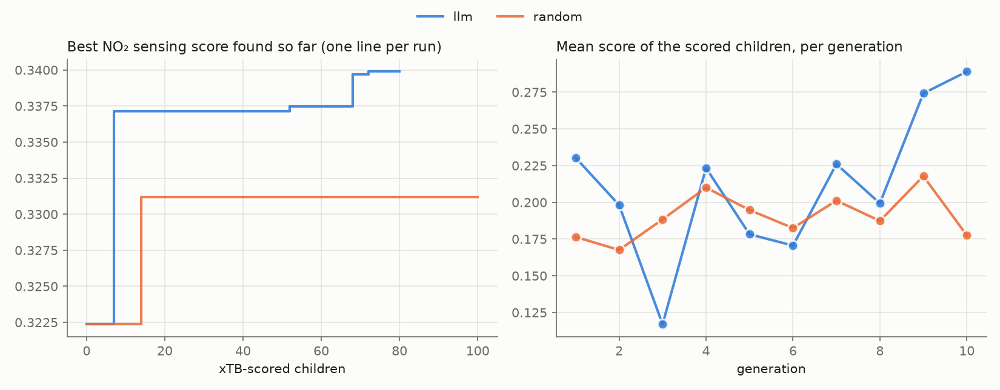
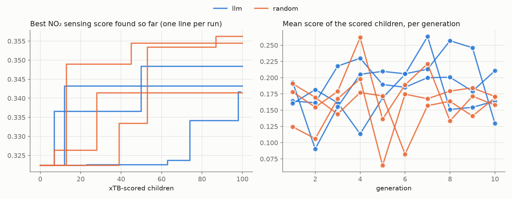

<!-- Created date: 2026-11-12 (America/Chicago) -->

# Stage 3: evolution loop for NO₂ sensing

The LLM suggests edits to the best GQDs found so far. Code checks every edit, and xTB scores the children with the Stage 3a NO₂ sensing score. The best GQDs become the next parents. Every child is logged, including rejected ones, because the logs are the fine-tuning data (`AGENTS.MD`).

## One generation

1. **Population:** the 8 best GQDs scored so far. The start is the top 8 of the 50 Stage 3a calibration GQDs (best score 0.322).
2. **Proposals:** the mutator makes children as edits on a parent: `ADD [q, r]` adds a hexagon, `REMOVE [q, r]` removes one, 1–3 edits per child.
   - `llm`: the agent's LLM (same Azure deployment and hexagon rules as Studio) sees each parent's hexagons, score, gap, NO₂ binding, bonded or not, the site, charge and CO margin, plus last generation's results. It returns edits with a one-sentence reason. Rejected children go back to it with the reason, including the closed-shell fix edits from Stage 1. That's up to 3 rounds.
   - `random`: random single-hexagon edits (1 or 2) on a random parent. This is the control.
3. **Checks (free):** the agent's checks (closed-shell, 20–40 hexagons, sp², SA score), plus:
   - new in this run;
   - not in the 91k dataset;
   - no holes.
4. **Gap pre-filter (free):** the Stage 2 predictor skips children with a predicted gap outside 0.30–1.60 eV. Below 0.4 eV, 9/10 calibration GQDs bond to NO₂; above 1.6 eV the response is weakest.
5. **xTB score:** up to 10 children per generation, Stage 3a `evaluate_gqd` with **NO₂ + CO only** (see below).
6. **Selection:** the next population is the 8 best GQDs scored so far that converged in xTB.

At the end, the 5 best new GQDs get the full Stage 3a check with all five gases (`final_check.csv`).

## Why it is affordable (the budget choice)

A full Stage 3a evaluation (5 gases, 12 xTB jobs) takes about 65 s per GQD. The loop cuts that in two ways, without changing the score:

- **Only NO₂ and CO are computed for children.** O₂ isn't scored (xTB gets it wrong). CO was the strongest competing gas for all 50 calibration GQDs, 0.06–0.1 eV above H₂O and NH₃. On the calibration set, the NO₂ + CO score equals the full score exactly (max difference 0.000). H₂O, NH₃ and O₂ are checked only for the final candidates.
- **Several children are scored at once.** xTB barely speeds up with more threads at this size, so 5 children run side by side, each with 6 single-thread jobs. Scoring 10 children takes about 3–4 min instead of about 11.

So a 10-generation × 10-child run is about 100 xTB scores and well under an hour. A trained surrogate for the score is left for later: the logged children will be its training data. Today's 50 calibration points are too few, and chemisorption is hard to predict from simple features (AUC 0.73 in Stage 3a).

## Logged fields (`results/<run>/children.jsonl`, one line per child)

These are the `AGENTS.MD` fields:
- `generation`, `goal`, `parent_id`, `parent_hexagons`, `parent_score`
- `edit`, `reason`, `child_hexagons`
- `valid`, `reject_reason`
- `predicted_gap`, `xtb_gap`

Plus:
- `skip_reason` (gap filter or budget), `round`, `smiles`
- all xTB numbers: `E_NO2_eV`, `q_NO2_e`, `dmin_NO2_A`, `NO2_chemisorbed`, `NO2_site`, `NO2_site_cell`, `E_CO_eV`, `selectivity_margin_eV`, `reversibility`, `charge_to_NO2_e`, `sensing_score`, `all_converged`
- per-job details in `xtb_details`

The raw energies and charges are stored, so the score can be recomputed later if its definition changes.

Other files per run:
- `config.json` (settings and the system prompt)
- `generations.jsonl` (one line per generation)
- `llm_log.jsonl` (every prompt and reply)
- `summary.md`

## Results

### Pilot (2026-11-12): `llm_s0` vs `random_s0`, 10 generations, one seed each

Both runs start from the same 8 GQDs (best 0.322). Each took about 55 min on the Mac with 5 children in parallel. Details: `results/compare.md`.

| | LLM | random |
|---|---|---|
| children proposed | 300 | 300 |
| valid (passed all checks) | 31% | 54% |
| xTB-scored | **80** (the LLM could not always fill 10 per generation) | 100 |
| beat their parent | 11% | 11% |
| NO₂ chemisorbed | 35% | 47% |
| mean score of scored children | 0.211 | 0.190 |
| best score found | **0.340** | 0.331 |
| children above the best start (0.322) | 10 | 9 |



The left panel's y-axis is zoomed in: 0.340 vs 0.331 is a 3% difference.

**What we learned**

- **The loop works end to end,** and every child is logged.
- **The cheaper scoring is confirmed.** The 10 best GQDs (5 per run) were re-scored with all five gases:
  - the loop score matched the full score within 0.002;
  - CO was always the strongest interferent;
  - NO₂ beats H₂O by at least 0.27 eV.
- **The LLM found the best GQD with fewer xTB runs,** and its children bonded NO₂ less often (35% vs 47%). Its mean score rose in the last generations (0.27–0.29, against 0.18–0.22 for random). But with one seed the difference is **not significant** (Mann-Whitney p = 0.20 on the scores). The gains (+0.018 over the start) are about the size of the xTB/site-sampling noise. This needs 3–5 seeds per mutator (Stage 4).
- **Pure carbon has little headroom:** 0.322 → 0.340 in 10 generations. Larger gains likely need dopants and edge groups (Stage 3b).

**Problems found (to fix before Stage 4)**

1. **LLM validity is low (31%).** Of the 300 LLM proposals:
   - 100 were open-shell, partly because the LLM uses 2–3 edits per child (random mostly uses 1);
   - 43 were duplicates;
   - about 30 had coordinate bookkeeping errors (ADD of a hexagon already there, REMOVE of one that isn't);
   - 10 used 4 edits.
   As a result, 6 of 10 generations scored fewer than 10 children.
2. **The LLM population lost diversity.** By generation 10, all 8 parents descend from one starting GQD (`gqd_14650`). The random run kept two families.
3. **O₂ in the final check:** xTB gives E_O₂ of −2.7 to −3.4 eV for the best GQDs. xTB is known to be wrong for O₂ (Stage 3a), but **air stability of the final candidates must be checked with DFT.**

**Best GQDs** (full check with all gases, `results/<run>/final_check.csv`). All are physisorbed.

| GQD | run | hex | gap (eV) | E_NO₂ (eV) | charge (e) | vs CO (eV) | vs H₂O (eV) | score |
|---|---|---|---|---|---|---|---|---|
| `g10c004` | LLM | 38 | 0.29 | −0.50 | 0.34 | +0.25 | +0.31 | **0.341** |
| `g10c007` | LLM | 37 | 0.30 | −0.50 | 0.34 | +0.25 | +0.31 | 0.340 |
| `g09c019` | LLM | 38 | 0.33 | −0.49 | 0.34 | +0.25 | +0.33 | 0.340 |
| `g07c026` | LLM | 36 | 0.30 | −0.49 | 0.34 | +0.24 | +0.31 | 0.338 |
| `g01c022` | LLM | 35 | 0.31 | −0.49 | 0.34 | +0.25 | +0.30 | 0.337 |
| `g02c004` | random | 35 | 0.36 | −0.49 | 0.33 | +0.24 | +0.30 | 0.331 |
| `g07c013` | random | 33 | 0.45 | −0.47 | 0.33 | +0.22 | +0.28 | 0.331 |

**The LLM pushed toward smaller gaps (0.29–0.33 eV) while keeping NO₂ physisorbed.** That's the top-left corner of the Stage 3a plot. These gaps sit at the lower edge of the 0.30 eV pre-filter, which may now be cutting off the most promising region. About 10 LLM children were skipped for a predicted gap below 0.30 eV.

### Stage 4 (2026-11-12): three seeds per mutator, loop v2

Six runs (`llm_v2_s1..3`, `random_v2_s1..3`), 10 generations × 10 children each, all starting from the same 8 GQDs (best 0.322). Details: `results/compare_v2.md`.

| | LLM s1 | LLM s2 | LLM s3 | random s1 | random s2 | random s3 |
|---|---|---|---|---|---|---|
| children proposed | 207 | 255 | 191 | 300 | 300 | 300 |
| valid | 59% | 45% | 60% | 84% | 84% | 79% |
| repaired by code (share of proposals) | 39% | 28% | 41% | 33% | 33% | 32% |
| xTB-scored | 99 | 100 | 100 | 100 | 100 | 100 |
| beat their parent | 13% | 12% | 7% | 13% | 9% | 5% |
| NO₂ chemisorbed | 49% | 54% | 51% | 52% | 65% | 60% |
| mean score of scored children | 0.194 | 0.172 | 0.191 | 0.178 | 0.157 | 0.154 |
| best score | 0.342 | 0.343 | 0.348 | **0.356** | 0.354 | 0.341 |
| children above the start (0.322) | 6 | 2 | 5 | 4 | 2 | 4 |
| LLM calls | 27 | 34 | 20 | n/a | n/a | n/a |

| mutator | best (mean ± sd) | mean scored (mean ± sd) | valid |
|---|---|---|---|
| LLM | 0.344 ± 0.004 | 0.186 ± 0.012 | 55% |
| random | 0.351 ± 0.008 | 0.163 ± 0.013 | 82% |



**What it shows**

- **The v2 fixes worked.** Every run used the full xTB budget, and validity rose for both mutators (LLM 31% → 45–60%, random 54% → 79–84%).
- **Best GQD: no LLM advantage.** Random found the best GQD in two of three seed pairs (0.356 and 0.354 vs 0.342 and 0.343); the LLM won the third (0.348 vs 0.341). The 0.007 difference in the mean best score is smaller than the spread between runs.
- **Average child: the LLM is better.** Its mean score was higher in all three pairs, and its children chemisorbed NO₂ less often in all three. Mann-Whitney on all scored children (LLM > random): p = 0.004. Children within a run are not independent, so this is a rough guide.
- **Full check:** the loop score matched the full score within 0.003 for all 30 GQDs. CO was the strongest interferent for 27; for 3 (random runs) NH₃ bound 0.001 eV more strongly, with no effect on the score.
- **All 40 fully checked GQDs** (pilot + Stage 4) physisorb NO₂ and have both score factors equal to 1, so their score is the xTB charge to NO₂. The DFT benchmark decides whether that ranking holds.
- `random_v2_s3` was interrupted after generation 5 and resumed with the same seed.

### Changes after the pilot (v2, used from Stage 4 on; both mutators get them)

1. **Code repairs open-shell children.** If a child has no closed-shell form, code tries the Stage 1 single-hexagon fixes and keeps the first one that passes all checks. The fix is logged as `repair`, and the LLM sees it in the history ("code added …").
   - On the pilot's proposals, this would raise validity from 31% to 50% (LLM) and from 54% to 81% (random).
2. **Family cap:** at most 3 of the 8 parents may descend from the same starting GQD (`--family-cap 3`). In the pilot, all 8 LLM parents came from one family.
3. **Gap floor 0.20 eV** (was 0.30). The best LLM GQDs sat right on the old floor.
4. **The LLM gets up to 4 proposal rounds** per generation (was 3).

Pilot runs (`llm_s0`, `random_s0`) were made before these changes and are kept as they are.

## How to run

```bash
.venv/bin/python Stage3/evolve.py --run llm_s0 --mutator llm --generations 10 --children 10 --parallel 5
.venv/bin/python Stage3/evolve.py --run random_s0 --mutator random --generations 10 --children 10 --parallel 5
.venv/bin/python Stage3/compare.py llm_s0 random_s0      # -> results/compare.md, compare.png
```

Restarting a run with the same `--run` resumes after the last finished generation. `--generations` can be raised to continue a finished run.

## Files

| File | What |
|---|---|
| `evolve.py` | the loop (mutators, checks, gap filter, xTB scoring, logging, final check) |
| `compare.py` | compares runs on the same xTB budget (table + plot) |
| `results/<run>/` | logs and summary of each run |

## Limitations

- The score uses xTB. Stage 3a's DFT check found that xTB overbinds NO₂ chemisorption and inflates the physisorbed charge (a ranking, not a real value). The best final GQDs need a DFT check.
- Three seeds per mutator (Stage 4). A paper needs more seeds and the random-generation baseline (E6).
- A shared cache of the 91k dataset's canonical SMILES is built on the first run, at `Stage1/data/known_canonical_smiles.txt.gz` (git-ignored, about 1 min to build).

## Score v2 option (added 2026-11-13 22:30 CST)

`evolve.py` also supports `--score v2 --fod-max 2.9` (Stage 4, see `Stage4/README.md`). Children are scored on NO₂, CO and H₂O, get an xTB N_FOD open-shell check, and are scored with score v2. Their geometries are kept for DFT. The default stays `--score v1`, so the runs above are unchanged and still resumable.
