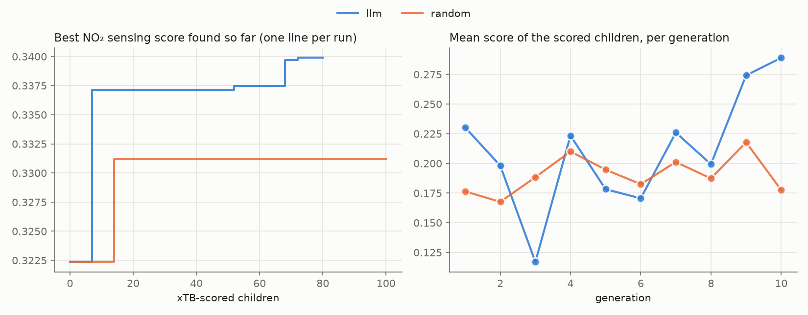

# Stage 3: evolution runs compared

All runs start from the same population (best score 0.322). The left plot's y-axis is zoomed in.

## Per run

| run | mutator | proposed | valid | repaired by code | xTB-scored | beat parent | NO2 chemisorbed | mean scored | best | above start (0.322) |
|---|---|---|---|---|---|---|---|---|---|---|
| llm_s0 | llm | 300 | 31% | 0% | 80 | 11% | 35% | 0.211 | 0.340 | 10 |
| random_s0 | random | 300 | 54% | 0% | 100 | 11% | 47% | 0.190 | 0.331 | 9 |

## Per mutator (mean ± sd over runs)

| mutator | runs | best | mean scored | valid |
|---|---|---|---|---|
| llm | 1 | 0.340 ± 0.000 | 0.211 ± 0.000 | 31% |
| random | 1 | 0.331 ± 0.000 | 0.190 ± 0.000 | 54% |

Mann-Whitney (scores of all scored children, LLM > random): p = 0.198. Children within a run are not independent, so treat this as a rough guide; the per-run best scores are the fairer comparison.

