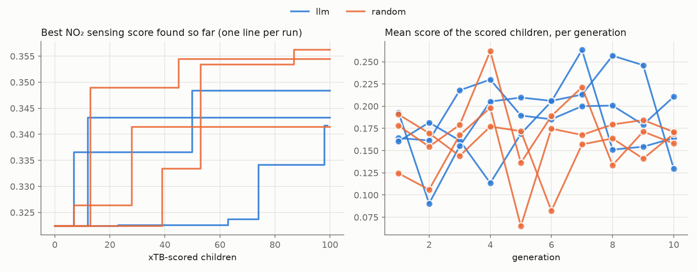

# Stage 3: evolution runs compared (v2)

All runs start from the same population (best score 0.322). The left plot's y-axis is zoomed in.

## Per run

| run | mutator | proposed | valid | repaired by code | xTB-scored | beat parent | NO2 chemisorbed | mean scored | best | above start (0.322) |
|---|---|---|---|---|---|---|---|---|---|---|
| llm_v2_s1 | llm | 207 | 59% | 39% | 99 | 13% | 49% | 0.194 | 0.342 | 6 |
| llm_v2_s2 | llm | 255 | 45% | 28% | 100 | 12% | 54% | 0.172 | 0.343 | 2 |
| llm_v2_s3 | llm | 191 | 60% | 41% | 100 | 7% | 51% | 0.191 | 0.348 | 5 |
| random_v2_s1 | random | 300 | 84% | 33% | 100 | 13% | 52% | 0.178 | 0.356 | 4 |
| random_v2_s2 | random | 300 | 84% | 33% | 100 | 9% | 65% | 0.157 | 0.354 | 2 |
| random_v2_s3 | random | 300 | 79% | 32% | 100 | 5% | 60% | 0.154 | 0.341 | 4 |

## Per mutator (mean ± sd over runs)

| mutator | runs | best | mean scored | valid |
|---|---|---|---|---|
| llm | 3 | 0.344 ± 0.004 | 0.186 ± 0.012 | 55% |
| random | 3 | 0.351 ± 0.008 | 0.163 ± 0.013 | 82% |

Mann-Whitney (scores of all scored children, LLM > random): p = 0.00398. Children within a run are not independent, so treat this as a rough guide; the per-run best scores are the fairer comparison.

