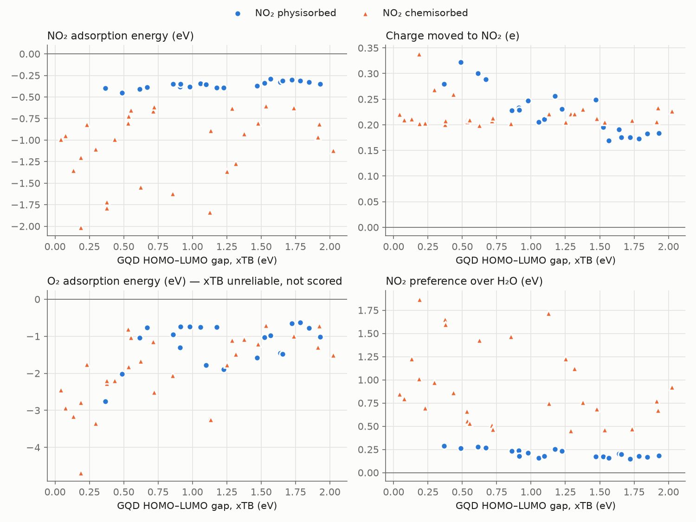
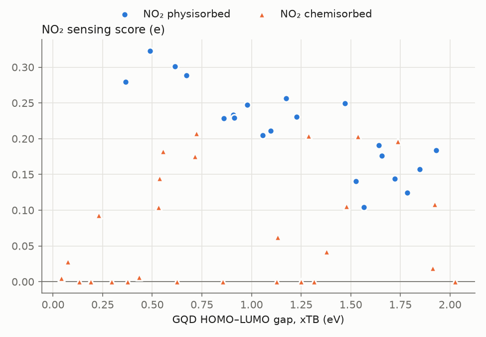

<!-- Created date: 2026-11-12 (America/Chicago) -->

# Stage 3a: An NO₂ gas-sensing score for any GQD (xTB)

## What this stage does

The project now designs GQDs for **one application: NO₂ gas sensing**. A good NO₂ sensor material must:

1. **Respond:** NO₂ takes electrons from the GQD, which changes its conductance. More charge moved means a bigger signal.
2. **Recover:** NO₂ must not stick so strongly that the sensor never resets.
3. **Be selective:** NO₂ must bind more strongly than the other gases in air (humidity H₂O, NH₃, CO).

This stage turns those three requirements into numbers that xTB can compute for **any** hexagon-list GQD. It combines them into one **NO₂ sensing score**, which becomes the goal of the Stage 3 evolution loop (in place of "hit a gap of X eV"). It also checks where xTB can be trusted, using DFT.

## How it works (`sensing.py`)

For one GQD (a hexagon list), `evaluate_gqd(hexagons)`:

1. **Builds the GQD geometry from the hexagon grid:** C–C 1.42 Å, one H per edge carbon at 1.09 Å, plus a tiny random out-of-plane nudge (0.05 Å, see "Bug found" below).
2. **Optimises the GQD with GFN2-xTB.**
3. **Places each gas 3.1 Å above two sites**, the most central hexagon and the most exposed edge hexagon:
   - NO₂ in two orientations (N down, O down);
   - H₂O, NH₃, CO and O₂ in one orientation each.
4. **Optimises all 12 complexes with xTB** (8 in parallel) and keeps the strongest-binding site and orientation for each gas.
5. **Returns:**
   - binding energy `E_ads = E(GQD+gas) − E(GQD) − E(gas)`;
   - charge on the gas;
   - shortest gas–GQD distance (below 1.9 Å means a covalent bond, i.e. **chemisorbed**);
   - selectivity margins, recovery time and the sensing score.

It takes about 65 s per GQD (15–130 s) on this Mac. The Homebrew `xtb` 6.7.1 crashes (gfortran format bug), so the code uses the conda-forge build at `../AI_GQD/.env/bin/xtb`. You can override this with the `XTB_BIN` environment variable.

## Bug found and fixed: GQDs stuck flat

- **What went wrong:** the first calibration run (kept in `data/run1_flat_start/`) started every GQD perfectly flat. Nearly all dataset GQDs have crowded edges (coves or fjords; 48 of 50 here), and their true shape is **twisted**. A flat start has no out-of-plane force, so the optimiser left them flat and strained.
- **Why it mattered:** a gas in a complex breaks the symmetry, the GQD twists and releases its strain, and that released energy was counted as "binding". In the worst case, water bound by −6.3 eV.
- **The fix:** the tiny nudge lets the GQD find its real twisted shape first (48 of 50 end up more than 0.5 Å out of plane).
- **Check:** our GQD gaps now match the dataset xTB gaps with a mean absolute difference of **0.036 eV (r = 0.984)**.

## Calibration: 50 dataset GQDs (`calibrate.py`, `analyze.py`)

The 50 GQDs come from the 14,674 xTB-labelled structures, 5 per 0.2 eV gap bin across 0–2.03 eV (20–37 hexagons). All 50 finished, and all optimisations converged. Full tables: `results/summary.md`.

| GQD gap (eV) | NO₂ binding (median) | NO₂ chemisorbed | Charge to NO₂ | H₂O / NH₃ / CO binding | Score median (max) |
|---|---|---|---|---|---|
| 0.0–0.4 | −1.15 eV | 9/10 | 0.21 e | −0.13 / −0.14 / −0.23 eV | 0.00 (0.28) |
| 0.4–0.8 | −0.66 | 7/10 | 0.21 | −0.14 / −0.14 / −0.24 | 0.18 (**0.32**) |
| 0.8–1.2 | −0.38 | 3/10 | 0.22 | −0.15 / −0.16 / −0.25 | 0.22 (0.26) |
| 1.2–1.6 | −0.62 | 6/10 | 0.22 | −0.15 / −0.15 / −0.25 | 0.12 (0.25) |
| 1.6–2.1 | −0.34 | 4/10 | 0.19 | −0.15 / −0.16 / −0.23 | 0.15 (0.20) |



What it shows:

- **There are two binding regimes:**
  - **Physisorbed NO₂ (21 of 50):** −0.29 to −0.45 eV. This is weak and reversible, with a recovery of well under a second.
  - **Chemisorbed NO₂ (29 of 50):** a C–N bond forms, at −0.6 to −2.0 eV in xTB.
  - Chemisorption is much more common for **small-gap GQDs**, but it happens at every gap. It's a **local** property of the site. No single structural feature predicts it well. The best predictors are many isolated edge C–H groups, fewer resonance structures and a smaller gap (AUC 0.73 at most).
- **The response grows as the gap shrinks:** for physisorbed NO₂ the charge moved rises from about 0.17 e (gap 1.9 eV) to about 0.32 e (gap 0.5 eV). A smaller gap means a higher HOMO, so the GQD gives electrons more easily.
- **Selectivity among H₂O, NH₃ and CO is not the bottleneck:** NO₂ always binds more strongly. CO is the closest competitor in all 50 cases, with a margin of 0.1–0.2 eV for physisorbed NO₂.
- **The trade-off:** a smaller gap gives more response but more risk of chemisorption, which means no recovery.

## xTB vs DFT check (`dft_check.py`, `xtb_vs_dft.py`)

xTB (GFN2) is known to overbind molecules with unpaired electrons, and NO₂ and O₂ are both such molecules. So I recomputed the binding with DFT (ωB97X-V/def2-SVP, PySCF) at the **same xTB geometries** for two small models that DFT can handle on this Mac:
- **tetracene**, where xTB chemisorbs NO₂;
- **coronene**, where xTB physisorbs NO₂.

| Model / complex | Distance (Å) | E_ads xTB | E_ads DFT | Charge xTB | Charge DFT |
|---|---|---|---|---|---|
| tetracene, NO₂ centre (chemisorbed) | 1.52 | −1.20 | **−0.76** | 0.20 | 0.19 |
| tetracene, NO₂ edge (chemisorbed) | 1.53 | −0.74 | **−0.19** | 0.19 | 0.19 |
| tetracene, NO₂ O-down (chemisorbed) | 1.47 | −0.68 | −0.59 | 0.26 | 0.27 |
| tetracene, O₂ centre | 1.45 | −1.52 | **+0.53** | 0.34 | 0.28 |
| tetracene, O₂ edge | 1.46 | −1.07 | **+1.10** | 0.36 | 0.28 |
| tetracene, H₂O | 2.69 | −0.12 | −0.24 | 0.01 | 0.01 |

| Model / complex | Distance (Å) | E_ads xTB | E_ads DFT | Charge xTB | Charge DFT |
|---|---|---|---|---|---|
| coronene, NO₂ centre (physisorbed) | 3.06 | −0.19 | −0.20 | 0.04 | 0.00 |
| coronene, NO₂ edge (physisorbed) | 2.55 | −0.24 | −0.06 | **0.13** | **0.04** |
| coronene, NO₂ O-down centre | 2.87 | −0.18 | −0.20 | **0.09** | **0.00** |
| coronene, NO₂ O-down edge | 2.75 | −0.18 | −0.20 | **0.09** | **0.00** |
| coronene, O₂ edge | 2.62 | −0.51 | **+0.23** | 0.30 | 0.03 |
| coronene, O₂ centre | 2.59 | −0.47 | +3.74* | 0.30 | 0.36* |
| coronene, CO centre / edge | 3.2 | −0.09 / −0.07 | −0.08 / −0.06 | 0.01 | 0.01 |
| coronene, NH₃ centre / edge | 2.9 | −0.14 / −0.13 | −0.22 / −0.19 | 0.00 | 0.00 |
| coronene, H₂O centre / edge | 2.7 | −0.13 / −0.12 | −0.26 / −0.24 | 0.01 | 0.01 |

\* This DFT calculation probably converged to the wrong electronic state, since a charge-separated state is unbound by 3.7 eV. Either way, O₂ is unbound in DFT.

Charges are from meta-Löwdin populations in DFT and from the xTB charges file. Raw tables: `data/dft_check/`.

What it shows:

- **Physisorption energies of closed-shell gases (CO, NH₃, H₂O) and of physisorbed NO₂: xTB is close to DFT** (within about 0.1 eV, apart from the small-basis overbinding of H₂O in DFT).
- **NO₂ chemisorption is real, but xTB overbinds it by 0.1–0.55 eV.** The score's recovery cut-off allows for this.
- **Charge moved to NO₂ has two cases:**
  - **Chemisorbed:** xTB matches DFT within about 0.01 e.
  - **Physisorbed:** xTB **overestimates** it (0.04–0.13 e vs 0.00–0.04 e on coronene). This is the same delocalisation error that makes xTB move charge to O₂.
  - **Consequence:** physisorbed charge values from xTB should not be read as real numbers. Their *ranking*, however, follows the GQD's HOMO energy very closely: across the 21 physisorbing calibration GQDs, charge vs dataset HOMO gives r = 0.88. A higher HOMO means a better electron donor, which is the physically right direction. So the response term ranks GQDs sensibly, but its magnitude is inflated.
- **O₂: xTB is wrong.** It says O₂ binds (−0.5 eV on coronene, −1 to −1.5 eV on tetracene), while DFT says O₂ does not bind at all. O₂ is therefore **not** used in the score. Air stability of the final candidates needs a DFT check.
- **Caveats for the DFT numbers:**
  - These are single points at xTB geometries, with no counterpoise correction. def2-SVP overbinds weak complexes by about 0.1 eV, which is why DFT gives −0.24 eV for H₂O.
  - The macOS PySCF wheel runs on one thread, and its density fitting crashes on molecules this size, so a full-size GQD is too slow for DFT here.

## GPU DFT benchmark: 12 GQDs, all gases (2026-11-13)

The same ωB97X-V/def2-SVP single points as above were run on a server A100 (GPU4PySCF 1.9.1), at the xTB geometries from `make_geometries.py`.
- **GQDs:** 10 calibration GQDs across the score range, plus the two pilot bests (`llm_s0_g10c004`, `random_s0_g02c004`).
- **Size of the run:** 162 single points, all converged, 11.7 GPU hours.
- **Scripts:** `dft_gpu.py` (runs the SCFs; `--summary-only` writes `data/dft_benchmark/summary.csv` and `<gqd>/dft.csv`), then `analyze_dft_benchmark.py`.
- **Results:** `results/dft_benchmark.md`, `results/dft_benchmark.csv`, `results/dft_vs_xtb.png`.

| xTB vs DFT across the 12 GQDs | Spearman ρ |
|---|---|
| E_NO2 | 0.74 |
| E_H2O / E_NH3 | 0.85 / 0.95 |
| E_CO | 0.10 (DFT: CO is not bound) |
| selectivity margin | 0.86 |
| **charge to NO₂** | **−0.11** |
| **sensing score** | **−0.16** |

What it shows:
- **Charge to physisorbed NO₂ is an xTB artefact.**
  - In the lowest DFT state, physisorbed NO₂ carries 0.01 e on average (34 complexes), against 0.23 e in xTB.
  - In 7 complexes the SCF found a charge-separated state (about 0.6 e), but it lies above the separated molecules (mean E_ads +0.52 eV), so it is not the adsorbed state.
  - Bonded NO₂ agrees in both methods (0.21 vs 0.23 e).
- **So the score fails.** The DFT score of every physisorbing GQD is about 0, including both pilot bests (0.000 and 0.002, against 0.341 and 0.331 in xTB).
  - By the rule fixed in advance (ρ < 0.4), the score must change (see `RESEARCH_OPTIONS.md` D7).
  - Only `gqd_13400` (0.105) and `gqd_58903` (0.066) keep a DFT score: they form a weak, reversible C–N bond (−0.31 and −0.41 eV in DFT) that moves about 0.19 e.
- **Binding and selectivity are ranked well by xTB.**
  - In DFT, water (not CO) is the strongest competing gas for all 12 GQDs, and margins are 0.17 eV smaller on average.
  - Bonded NO₂ is 0.18 eV weaker in DFT than in xTB.
- **O₂ does not bind in DFT** on 11 of 12 GQDs (up to +0.99 eV; the pilot bests +0.41 and +0.55 eV). xTB gave −0.76 to −2.82 eV. `gqd_18941` physisorbs O₂ weakly (−0.20 eV).
- **Caveats:**
  - single points at xTB geometries;
  - no counterpoise, so H₂O and NH₃ are overbound by about 0.1 to 0.2 eV in SVP;
  - meta-Löwdin charges;
  - the small-gap GQDs may have open-shell character, so their RKS reference could be too high (see the broken-symmetry check in `results/dft_benchmark.md`).

## The sensing score

```text
score = response × reversibility × selectivity          (units: e; higher is better)

response      = charge moved to NO2 at its strongest site (e; xTB, a ranking, inflated for physisorption)
reversibility = 1 if E_NO2 ≥ −0.6 eV, falling linearly to 0 at E_NO2 = −1.0 eV (xTB)
selectivity   = 1 if NO2 binds ≥ 0.10 eV more strongly than H2O, NH3 and CO, else proportionally less
```

- **Why −0.6 / −1.0 eV:** xTB overbinds chemisorbed NO₂ by about 0.1–0.55 eV. So −1.0 eV in xTB is roughly −0.5 to −0.9 eV in DFT.
  - Room-temperature recovery is τ = 10⁻¹² s · exp(|E|/kT): about 0.3 ms at 0.5 eV, 7 s at 0.76 eV, 27 min at 0.9 eV and 22 h at 1.0 eV.
  - So the cut-off removes GQDs that may never recover, while allowing for xTB's error. Physisorbed NO₂ (−0.3 to −0.45 eV) always gets full reversibility.
- **Result:** 38 of 50 GQDs score above 0. The **best scores (0.28–0.32) all come from physisorbing GQDs with a gap of about 0.35–0.7 eV.**



**This gives Stage 3 an application-driven goal.** We no longer pick a target gap by hand. The sensing requirements favour a GQD with a **moderately small gap (about 0.35–0.7 eV) that does *not* form a bond with NO₂**. That's a real design problem: in that gap range, 7 of 10 dataset GQDs chemisorb.

Top 3 in the calibration set: `gqd_18941` (score 0.32, gap 0.49 eV), `gqd_23821` (0.30, 0.61 eV), `gqd_90531` (0.29, 0.67 eV).

## Limitations

- **Only 2 sites** (centre and most exposed edge) and one orientation per interfering gas. A GQD could chemisorb NO₂ at a site we don't probe. For Stage 3 finalists, all symmetry-distinct sites should be checked.
- **Simplified conditions:** gas phase, one molecule, 0 K energies; no humidity coverage, temperature or pressure effects.
- **No O₂ / air-stability check at the xTB level.** It needs DFT.
- **Pure-carbon GQDs only.** Dopants and edge groups (Stage 3b) could raise the response or block chemisorption.
- **Cost:** about 65 s per GQD, so the evolution loop needs a budget, or a fast surrogate trained on these results, much as the Stage 2 predictor does for the gap.

## Files

| File | What it does |
|---|---|
| `sensing.py` | `evaluate_gqd(hexagons)` → all descriptors and the score. Also `gqd_geometry`, `adsorption_sites`, `place_gas`, `run_xtb`, `sensing_numbers`. |
| `calibrate.py` | Runs `evaluate_gqd` on a gap-stratified dataset sample. It saves after each GQD and resumes if interrupted. |
| `analyze.py` | Writes `results/summary.md` and the two plots, and recomputes the score from the stored raw numbers. |
| `dft_check.py` | DFT single points (ωB97X-V/def2-SVP) on the xTB geometries saved by `evaluate_gqd(..., keep_dir=...)`. |
| `xtb_vs_dft.py` | xTB single points on the same geometries, merged with the DFT results. |
| `data/calibration.csv` | One row per GQD: binding energies, charges, distances, sites, gap, timing. |
| `data/calibration_details.csv` | One row per GQD × gas × site × orientation. |
| `data/calibration_sample.csv` | The 50 GQDs chosen (seed 0). |
| `data/run1_flat_start/` | The first run, before the flat-start fix (kept for the record). |
| `data/dft_check/` | xTB-vs-DFT tables for tetracene and coronene. |
| `results/` | `summary.md`, `sensing_vs_gap.png`, `score_vs_gap.png`. |

## How to run

```bash
cd Agentic_GQD
.venv/bin/python Stage3a/calibrate.py --n 50          # about 55 min with 8 parallel xTB jobs
.venv/bin/python Stage3a/analyze.py
```

```python
from Stage3a.sensing import evaluate_gqd
result = evaluate_gqd([[0, 0], [1, 0], ...])   # result["sensing_score"], result["E_NO2_eV"], ...
```
