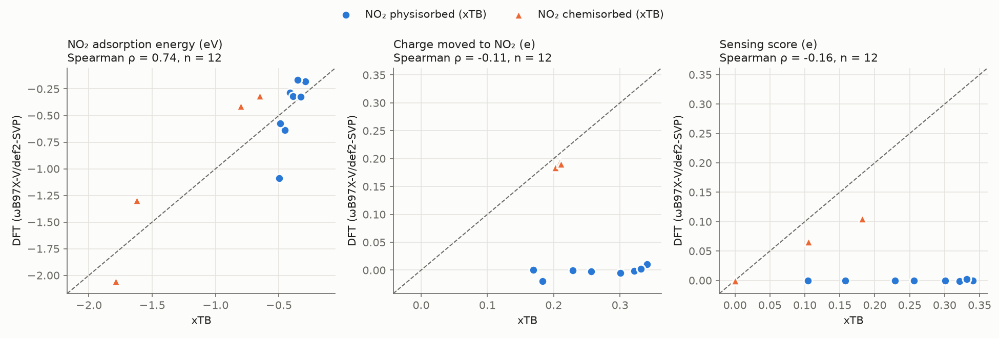

# GPU DFT benchmark vs xTB (all 162 single points)

wB97X-V/def2-SVP single points (GPU4PySCF, one A100) at the xTB geometries of 12 GQDs, all five gases. Source: `Stage3a/data/dft_benchmark/` (summary.csv, <gqd>/dft.csv).

All DFT SCFs converged: True.

## Per GQD (n = 12): xTB vs DFT

| quantity | Spearman rho | Pearson r | MAE | mean DFT - xTB |
|---|---|---|---|---|
| E_NO2 | 0.74 | 0.87 | 0.223 | +0.035 |
| q_NO2 | -0.11 | -0.45 | 0.185 | -0.185 |
| E_CO | 0.10 | 0.12 | 0.330 | +0.330 |
| E_H2O | 0.85 | 0.88 | 0.220 | -0.220 |
| E_NH3 | 0.95 | 0.94 | 0.144 | -0.144 |
| E_O2 | -0.44 | -0.28 | 1.840 | +1.840 |
| margin | 0.86 | 0.90 | 0.269 | -0.167 |
| score | -0.16 | -0.15 | 0.180 | -0.180 |

Physisorbing GQDs only (n = 8):

| quantity | Spearman rho | Pearson r | MAE | mean DFT - xTB |
|---|---|---|---|---|
| E_NO2 | 0.76 | 0.82 | 0.169 | -0.046 |
| q_NO2 | 0.48 | 0.57 | 0.268 | -0.268 |
| score | 0.08 | 0.12 | 0.255 | -0.255 |

## Per complex

| analyte | geometry | DFT state | n | E xTB mean | E DFT mean | E rho | charge xTB mean | charge DFT mean |
|---|---|---|---|---|---|---|---|---|
| CO | physisorbed | neutral | 24 | -0.214 | 0.124 | 0.346 | 0.068 | 0.048 |
| H2O | physisorbed | neutral | 24 | -0.136 | -0.316 | 0.910 | 0.007 | 0.003 |
| NH3 | physisorbed | neutral | 24 | -0.149 | -0.262 | 0.810 | 0.003 | -0.005 |
| NO2 | bonded | neutral | 7 | -0.902 | -0.725 | 0.964 | 0.225 | 0.210 |
| NO2 | physisorbed | charge-separated | 7 | -0.444 | 0.515 | 0.821 | 0.315 | 0.596 |
| NO2 | physisorbed | neutral | 34 | -0.324 | -0.260 | 0.318 | 0.226 | 0.013 |
| O2 | bonded | charge-separated | 6 | -2.430 | 0.814 | 1.000 | 0.426 | 0.469 |
| O2 | bonded | neutral | 5 | -1.212 | 0.962 | 0.800 | 0.444 | 0.286 |
| O2 | physisorbed | charge-separated | 1 | -0.809 | 2.158 | nan | 0.455 | 0.422 |
| O2 | physisorbed | neutral | 12 | -0.693 | 0.330 | -0.462 | 0.389 | 0.051 |

## Per GQD values (sorted by xTB score)

| name | gap_xTB | chemisorbed | E_NO2_xTB | E_NO2_DFT | q_NO2_xTB | q_NO2_DFT | margin_xTB | margin_DFT | interferent_DFT | E_O2_xTB | E_O2_DFT | score_xTB | score_DFT |
|---|---|---|---|---|---|---|---|---|---|---|---|---|---|
| llm_s0_g10c004 | 0.289 | False | -0.498 | -1.090 | 0.341 | 0.010 | 0.249 | 0.634 | H2O | -2.823 | 0.408 | 0.341 | 0.000 |
| random_s0_g02c004 | 0.365 | False | -0.490 | -0.575 | 0.331 | 0.002 | 0.252 | 0.105 | H2O | -2.754 | 0.553 | 0.331 | 0.002 |
| gqd_18941 | 0.486 | False | -0.453 | -0.637 | 0.322 | -0.002 | 0.203 | 0.113 | H2O | -2.020 | -0.201 | 0.322 | -0.002 |
| gqd_23821 | 0.590 | False | -0.411 | -0.284 | 0.301 | -0.005 | 0.180 | -0.030 | H2O | -1.046 | 0.722 | 0.301 | -0.000 |
| gqd_26676 | 1.215 | False | -0.390 | -0.320 | 0.256 | -0.002 | 0.137 | 0.015 | H2O | -0.759 | 0.180 | 0.256 | -0.000 |
| gqd_88143 | 0.861 | False | -0.351 | -0.168 | 0.229 | -0.000 | 0.122 | -0.086 | H2O | -0.959 | 0.231 | 0.229 | -0.000 |
| gqd_13400 | 0.562 | True | -0.653 | -0.313 | 0.209 | 0.194 | 0.430 | 0.054 | H2O | -1.025 | 0.295 | 0.182 | 0.105 |
| gqd_48745 | 1.913 | False | -0.328 | -0.325 | 0.183 | -0.020 | 0.086 | -0.149 | H2O | -0.774 | 0.116 | 0.158 | -0.000 |
| gqd_58903 | 0.526 | True | -0.801 | -0.412 | 0.211 | 0.190 | 0.551 | 0.035 | H2O | -0.809 | 0.217 | 0.105 | 0.066 |
| gqd_16232 | 1.566 | False | -0.290 | -0.181 | 0.169 | 0.001 | 0.062 | -0.206 | H2O | -0.979 | 0.214 | 0.104 | 0.000 |
| gqd_10544 | 0.378 | True | -1.789 | -2.057 | 0.201 | 0.182 | 1.550 | 1.775 | H2O | -2.272 | 0.988 | 0.000 | 0.000 |
| gqd_23775 | 0.846 | True | -1.622 | -1.296 | 0.202 | 0.184 | 1.397 | 0.956 | H2O | -2.051 | 0.091 | 0.000 | 0.000 |

## Broken-symmetry check

Question: is the bare GQD really closed-shell in DFT? Script `Stage3a/bs_check.py` computes, for the bare GQD at its xTB geometry, the wB97X-V/def2-SVP energy with RKS and with UKS started from a broken-symmetry guess (HOMO and LUMO mixed at 45 degrees with opposite sign for alpha and beta), plus <S^2> of the UKS solution. Source: `Stage3a/data/dft_benchmark/bs_check.jsonl` (copied 2026-11-13). Four rows exist, all UKS runs converged; no `bs_check` process was running on the server at copy time, so these are all the rows there are. The other 8 GQDs were not checked, including four with xTB gap below 0.6 eV (gqd_10544 0.378, gqd_58903 0.526, gqd_13400 0.562, gqd_23821 0.590).

| name | gap_xTB (eV) | RKS gap, DFT (eV) | lowering E(RKS) - E(BS-UKS) (eV) | <S^2> | E_NO2_DFT (eV) | E_NO2_DFT with BS-UKS GQD (eV) |
|---|---|---|---|---|---|---|
| llm_s0_g10c004 | 0.289 | 2.91 | 0.816 | 1.67 | -1.090 | -0.274 |
| random_s0_g02c004 | 0.365 | 3.30 | 0.682 | 1.48 | -0.575 | +0.107 |
| gqd_18941 | 0.486 | 3.53 | 0.434 | 1.67 | -0.637 | -0.203 |
| gqd_88143 | 0.861 | 4.51 | 0.043 | 0.62 | -0.168 | -0.125 |

The last column is E_NO2_DFT plus the lowering, i.e. the adsorption energy with the BS-UKS energy of the bare GQD as reference instead of the RKS energy.

What it means:

- The three GQDs with xTB gap below 0.5 eV have a broken-symmetry UKS solution 0.43 to 0.82 eV below RKS, with <S^2> of 1.5 to 1.7 (a pure singlet has 0, a clean diradical about 1). In DFT these GQDs have strong open-shell (diradical or polyradical) character, although each has a Kekule structure and passed our closed-shell check. The lowering grows as the xTB gap shrinks; gqd_88143 (xTB gap 0.86 eV) is nearly closed-shell (0.04 eV).
- The DFT NO2 adsorption energies of these GQDs were too negative: the complex (UKS) could spin-polarise but the bare GQD reference (RKS) could not. With the BS-UKS reference the strong DFT binding of llm_s0_g10c004 (-1.09 eV) drops to about -0.27 eV, and random_s0_g02c004 no longer binds (+0.11 eV). If the complex UKS did not reach its own lowest broken-symmetry state, the true value lies between the two columns.
- The charge result does not depend on this. DFT puts about 0 e on physisorbed NO2 for gqd_88143, which is closed-shell, as well as for the open-shell GQDs.
- For the pipeline: the Kekule (closed-shell) check is topological and does not exclude open-shell character. GQDs with small xTB gap, which include the best GQDs of both pilot runs, can be open-shell at the DFT level, so both the xTB scores (closed-shell GFN2) and the RKS-referenced DFT energies of those GQDs rest on a questionable reference.

Limits: single points at xTB geometries (no UKS geometry relaxation), one functional (wB97X-V; the size of the lowering depends on the functional), small basis (def2-SVP), one broken-symmetry guess (HOMO/LUMO only), only 4 of 12 GQDs, and <S^2> of a BS-UKS determinant is a qualitative measure of open-shell character, not a spin state.
