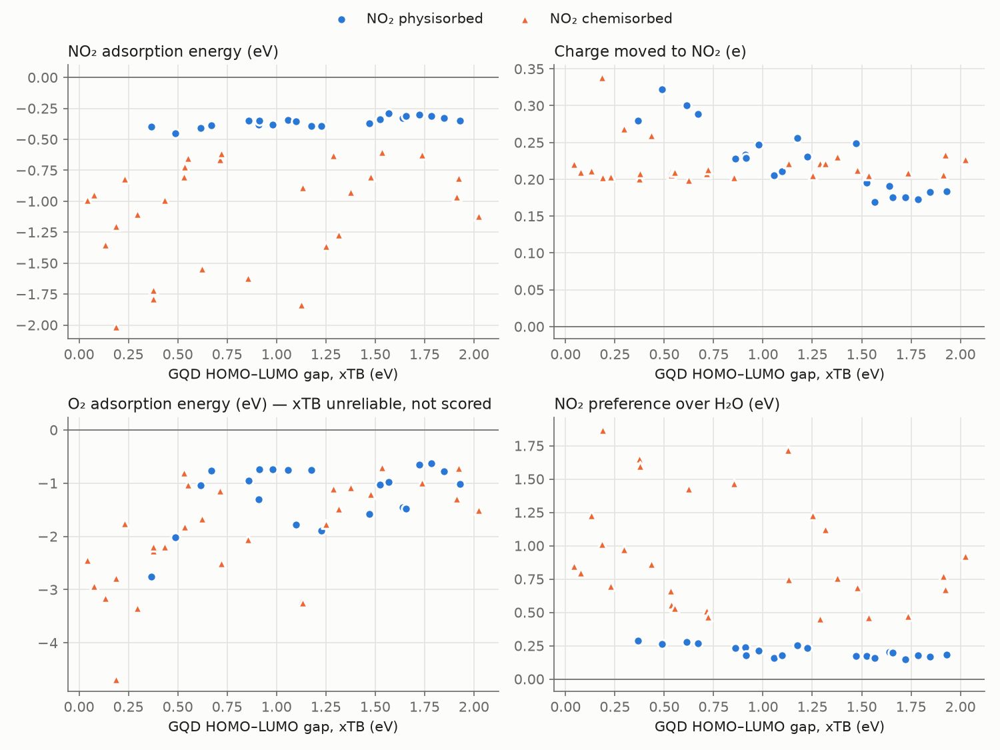
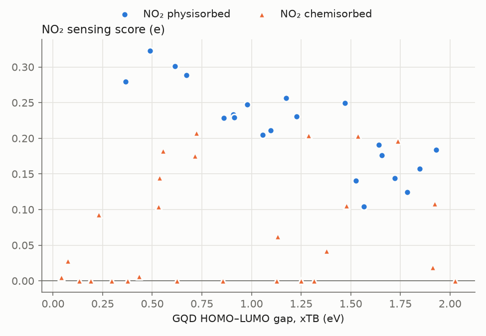

# Stage 3a calibration: NO₂ sensing numbers for dataset GQDs

50 GQDs, gap-stratified, 20-37 hexagons. All optimisations converged: 50/50. Mean time per GQD: 65 s.

## Check: our GQD gap vs the dataset xTB gap

Mean difference +0.010 eV, mean absolute 0.036 eV, Pearson r = 0.984.

## By gap range (medians; energies in eV, charge in e)

| gap (eV) | n | E_NO2 | charge_NO2 | NO2_chemisorbed | E_O2 | O2_chemisorbed | E_H2O | E_NH3 | E_CO | score_median | score_max |
|---|---|---|---|---|---|---|---|---|---|---|---|
| (0.0, 0.4] | 10 | -1.15 | 0.21 | 9/10 | -2.77 | 10/10 | -0.13 | -0.14 | -0.23 | 0.00 | 0.28 |
| (0.4, 0.8] | 10 | -0.66 | 0.21 | 7/10 | -1.40 | 8/10 | -0.14 | -0.14 | -0.24 | 0.18 | 0.32 |
| (0.8, 1.2] | 10 | -0.38 | 0.22 | 3/10 | -1.13 | 6/10 | -0.15 | -0.16 | -0.25 | 0.22 | 0.26 |
| (1.2, 1.6] | 10 | -0.62 | 0.22 | 6/10 | -1.16 | 9/10 | -0.15 | -0.15 | -0.25 | 0.12 | 0.25 |
| (1.6, 2.1] | 10 | -0.34 | 0.19 | 4/10 | -1.01 | 6/10 | -0.15 | -0.16 | -0.23 | 0.15 | 0.20 |

Chemisorbed = shortest gas-GQD distance < 1.9 Å after optimisation (a covalent bond formed).

## Spearman correlation of each descriptor with gap, HOMO and size

| descriptor | vs gap | vs HOMO | vs size |
|---|---|---|---|
| E_NO2_eV | 0.48 | -0.49 | -0.24 |
| charge_to_NO2_e | -0.33 | 0.32 | 0.38 |
| E_O2_eV | 0.60 | -0.60 | -0.21 |
| E_H2O_eV | -0.24 | 0.23 | 0.21 |
| humidity_margin_eV | -0.47 | 0.48 | 0.25 |
| selectivity_margin_eV | -0.45 | 0.46 | 0.25 |
| sensing_score | 0.17 | -0.18 | 0.09 |

## NO₂ sensing score

score = charge to NO₂ × reversibility × selectivity. Reversibility is 1 for E_NO2 ≥ -0.6 eV and falls linearly to 0 at -1.0 eV. Selectivity is 1 when NO₂ binds ≥ 0.1 eV more strongly than H₂O, NH₃ and CO. O₂ is not scored (xTB unreliable for O₂).

Score > 0 for 38/50 GQDs; selectivity < 1 for 7/50.

### Top 10

| Structure_Name | n_hex | dataset_gap_eV | E_NO2_eV | NO2_bond | charge_to_NO2_e | reversibility | selectivity_margin_eV | sensing_score |
|---|---|---|---|---|---|---|---|---|
| gqd_18941 | 30 | 0.49 | -0.45 | physisorbed | 0.32 | 1.00 | 0.20 | 0.32 |
| gqd_23821 | 36 | 0.61 | -0.41 | physisorbed | 0.30 | 1.00 | 0.18 | 0.30 |
| gqd_90531 | 35 | 0.67 | -0.38 | physisorbed | 0.29 | 1.00 | 0.11 | 0.29 |
| gqd_14650 | 33 | 0.37 | -0.40 | physisorbed | 0.28 | 1.00 | 0.19 | 0.28 |
| gqd_26676 | 23 | 1.17 | -0.39 | physisorbed | 0.26 | 1.00 | 0.14 | 0.26 |
| gqd_71365 | 22 | 1.47 | -0.37 | physisorbed | 0.25 | 1.00 | 0.14 | 0.25 |
| gqd_95647 | 31 | 0.98 | -0.38 | physisorbed | 0.25 | 1.00 | 0.12 | 0.25 |
| gqd_36414 | 25 | 0.91 | -0.38 | physisorbed | 0.23 | 1.00 | 0.13 | 0.23 |
| gqd_80773 | 22 | 1.23 | -0.39 | physisorbed | 0.23 | 1.00 | 0.15 | 0.23 |
| gqd_26145 | 27 | 0.91 | -0.35 | physisorbed | 0.23 | 1.00 | 0.11 | 0.23 |

