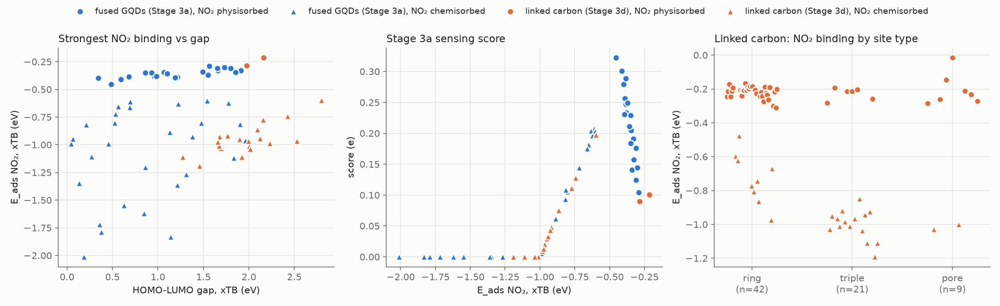

<!-- Created date: 2026-11-12 (America/Chicago) -->

# Stage 3d: linked carbon (L1: representation, builder, checks; L2: NO₂ scoring)

This stage extends the design space from fused hexagons (GQDs) to **linked carbon**: units of fused hexagons joined by acetylene links, as in graphyne (`-C≡C-`) and graphdiyne (`-C≡C-C≡C-`). Benzene-only units give graphyne/graphdiyne fragments, and fused units give GQD–graphyne hybrids. The choices are recorded in `RESEARCH_OPTIONS.md` as D16, D17 and D20.

L1 covers the representation, the 3D builder and the validity checks. There is no scoring and no evolution loop yet. The step-by-step log, with every test output, is in `PROGRESS.md`.

## Representation (what the LLM will write)

```json
{"units": {"A": [[0,0]], "B": [[0,0],[1,0]]},
 "place": {"A": [0,0], "B": [1,0]},
 "links": [["A","B",1]]}
```

- **units:** hexagon lists in the Stage 1 format, so a unit is benzene or a small GQD.
- **place:** each unit on a coarse grid with the same axial neighbour rules (`[1,0], [-1,0], [0,1], [0,-1], [1,-1], [-1,1]`). Links may only join neighbouring places.
- **links:** `n = 1` (`-C≡C-`) or `n = 2` (`-C≡C-C≡C-`).

## How it is built (`linked.py`, `build()`)

1. **Checks:** names, places, links, and connectivity through links. Each unit must be closed-shell on its own; the Stage 1 open-shell message with fix edits is reused.
2. **Attach carbons:** the coarse grid is the hexagon grid rotated by 30°, so each link direction is a direction in which edge C–H bonds point. A link leaves a unit from its outermost edge carbon whose C–H points along the link, and that carbon loses its H.
3. **Placement:** units are placed along a spanning tree of the links, so that every link is straight at its ideal length. That is 4.01 Å between attach carbons for n=1 and 6.57 Å for n=2.
   - A link that closes a ring must fit within 15% in length and 15° in angle, or the structure is rejected.
4. **RDKit molecule:** the Kekulé structure of each unit, plus single and triple bonds in the links. It is sanitised, written as canonical SMILES and read back.
5. **3D start geometry:**
   - bond lengths: ring 1.42, sp2–sp 1.40, C≡C 1.21, sp–sp 1.35, C–H 1.09 Å;
   - an atom clash check between parts (at least 1.6 Å);
   - out-of-plane noise with σ = 0.05 Å, seeded by the SMILES.
6. **Size limit:** 40 to 150 carbon atoms, checked last. The current GQDs have 64 to 118 carbons.

Every rejection is a `LinkError` with a plain-language reason, written for the LLM to act on (same style as `HexError`).

## Tests (`test_linked.py`, output in `test_output.txt`): 14 of 14 pass

| Test | Result (computed) |
|---|---|
| Diphenylacetylene (n=1) | `C(#Cc1ccccc1)c1ccccc1`, C14H10: same as RDKit canonical SMILES of the known molecule |
| Diphenylbutadiyne (n=2) | `C(C#Cc1ccccc1)#Cc1ccccc1`, C16H10: same as the known molecule |
| Benzene triangle, n=1 | C24H12, rings [6, 6, 6, 12]; ring-closing link exactly 4.01 Å, 0° off |
| Benzene triangle, n=2 | C30H12, rings [6, 6, 6, 18]; ring-closing link exactly 6.57 Å, 0° off |
| Naphthalene unit + benzene, n=1 | C18H12, one triple bond |
| Coronene unit + two benzenes, n=2 | C44H20, accepted with the default size limit |
| 8 invalid inputs | All rejected with their own message: non-neighbours, n=3, unlinked unit, two units in one place, open-shell unit (phenalenyl, with fix feedback), mixed link lengths in a ring, too small, overlapping parts |

## xTB check (`xtb_check.py`, output in `results/xtb_check.md`)

| Structure | Formula | Converged | GFN2-xTB gap (eV) | C≡C (Å) | Angle at sp C (°) | 6-ring C–C (Å) | Out-of-plane span (Å) |
|---|---|---|---|---|---|---|---|
| triangle_n1 | C24H12 | True | 2.188 | 1.208 | 179.6–179.9 | 1.383–1.410 | 0.02 |
| triangle_n2 | C30H12 | True | 2.416 | 1.215 | 179.0–179.6 | 1.380–1.413 | 0.01 |
| coronene_2benz_n2 | C44H20 | True | 2.052 | 1.214–1.215 | 179.4–179.7 | 1.362–1.431 | 0.05 |

The start geometries optimise cleanly. These gaps are xTB values and are not checked against DFT.

## Limitations

- Mixed link lengths around a ring are rejected, not relaxed.
- Attach carbons are chosen by a fixed rule; the LLM cannot pick a different edge carbon.
- The clash check covers only atoms of different parts. Inside a unit, the geometry is the same as in Stage 3a.
- No pentagons or heptagons, no heteroatoms, no free (dangling) links.
- Only small structures have been optimised so far (24 to 44 carbons). Designs of 40 to 150 carbons have not yet been run through xTB at scale.

## What L2 (scoring) needs

- **Adsorption sites for linked carbon:** ring centres (exists), triple-bond midpoints (new), and pore centres of rings formed by links (new; the 12- and 18-membered rings above).
- **`evaluate_gqd` for linked structures:** it currently takes a hexagon list. It needs a version that starts from `build()`'s symbols and coordinates and places gases above the new sites. The Stage 3a gas placement and score code can be reused.
- **A short calibration set** of hand-made linked structures, plus a DFT check of one or two, because triple-bond carbons may bind NO₂ strongly, which the reversibility term must handle.
- **No gap pre-filter** until a predictor is trained on linked structures; the Stage 2 predictor only knows fused GQDs.

## Run

```bash
.venv/bin/python Stage3d/test_linked.py     # 14 tests
.venv/bin/python Stage3d/xtb_check.py       # GFN2-xTB check of 3 structures (a few seconds)
```

---

# L2: NO₂ sensing descriptors and calibration (2026-11-13)

The step-by-step log, with every number, is in `PROGRESS.md`.

## Code

| File | What it does |
|---|---|
| `sensing_linked.py` | `evaluate_linked(design, analytes, threads, workers, keep_dir)`: the Stage 3a workflow on a `build()` geometry. It gives the same output keys as `evaluate_gqd`, so `Stage3a.sensing.sensing_numbers` and `Stage3c/twin.py twin()` work unchanged. It reuses `run_xtb`, `gas_reference`, `place_gas` and `sensing_numbers` from Stage 3a; `Stage3a/sensing.py` is not modified. |
| `consistency_test.py` | One-unit designs (plain GQDs) against the stored Stage 3a numbers |
| `designs.py` | 23 hand-made designs: graphyne and graphdiyne flakes, plus hybrids with naphthalene, pyrene, coronene, ovalene and circumcoronene units. 21 of them build. |
| `calibrate_linked.py` | Evaluates all buildable designs with all 5 gases. Resumable; keeps the geometries in `data/geometries/`. |
| `analyze_linked.py` | Comparison with the 50 fused Stage 3a GQDs, using both scores → `results/summary.md`, `calibration_linked.csv`, `calibration_linked_sites.csv`, `linked_vs_fused.png` |
| `prepare_dft.py` | Puts kept geometries into the layout `Stage3a/dft_gpu.py` expects |

**Sites:**
- `centre` and `edge` 6-rings, with the Stage 3a rules;
- `triple`: the C≡C nearest the middle;
- `pore`: the macrocycle nearest the middle.

With all 5 gases that is 12, 18 or 24 complexes per design. For each gas, the strongest site and orientation is kept. A site label means where the gas *started*: two NO₂ molecules placed above a pore ended up bonded to a nearby carbon.

## Consistency test

Two 20-hexagon calibration GQDs (`gqd_34862` physisorbs NO₂, `gqd_03389` chemisorbs) were evaluated as one-unit designs.

- **Same start geometry as Stage 3a:** every difference is 0.0003 eV or less (gap, E and q of all 5 gases), with the same NO₂ site and the same score. The code path is consistent.
- **The builder's own start noise** (seeded by the SMILES) gives differences of up to 0.08 eV in the gap and 0.09 eV in E_CO (0.24 eV for E_O₂). For `gqd_34862` the best NO₂ site moved from edge to centre.
  - Both GQDs are strongly twisted (3 to 4.5 Å out of plane), and a different start noise lets xTB settle in a different twisted conformer.
  - This **conformer noise** affects Stage 3a in the same way and was not measured before. Differences below about 0.05 to 0.1 eV between twisted structures are not meaningful.

## Calibration: 21 linked designs vs 50 fused GQDs (xTB)

| | fused | linked |
|---|---|---|
| gap median (eV) | 1.02 | 1.99 |
| strongest E_NO2 median (eV) | −0.642 | −0.967 |
| NO₂ chemisorbed | 29/50 | 19/21 |
| NO₂ over CO margin median (eV) | 0.384 | 0.756 |
| Stage 3a score: median / max | 0.142 / 0.322 | 0.020 / 0.197 |
| meet the twin's 5-min recovery | 32 | 5 |

| NO₂ site type | sites | E_NO2 median (eV) | chemisorbed |
|---|---|---|---|
| ring | 42 | −0.232 | 11 |
| triple bond | 21 | −0.951 | 15 |
| pore | 9 | −0.261 | 2 |



**What it shows (xTB level):**
- **The triple bond is the reactive site.** It chemisorbs NO₂ in most designs, so linked carbon is more selective over CO (margin 0.76 vs 0.38 eV) but mostly binds too strongly for the Stage 3a reversibility window. Its best Stage 3a score is 0.197 (`gy_ring6`), against 0.322 for fused GQDs.
- **Pores bind weakly** (about −0.26 eV), so they are not useful NO₂ sites.
- **On the sensor twin, the best linked designs are hybrids that bind NO₂ at a fused-unit ring:**
  - `naph_row4_n1`: −0.77 eV, 11 s recovery, response 0.115 e per site;
  - `pyrene_row3_n1`: −0.74 eV, 3.6 s recovery, response 0.063.
  - The best fused GQD in the twin reaches 0.205.
- The two scores rank designs differently (open decision D19), and triple-bond reactivity is open decision D21.

## Limitations

- All values are xTB.
  - xTB overbinds NO₂ chemisorption on rings by 0.1 to 0.55 eV (Stage 3a DFT check).
  - **Triple-bond chemisorption has not been checked with DFT.** If xTB overbinds it in the same way, many triple-bond sites (−0.9 to −1.0 eV) would move into the twin's preferred window (about −0.75 eV).
- There are 21 hand-made designs, not a systematic sample. Ring closure rejected two designs (`pyrene_tri3_n2`, `coronene_tri3_n1`).
- The probed sites are one triple bond and one pore (those nearest the middle); others may differ.
- The humidity-equivalent NO₂ reported by the twin is at the bisection floor (1e-6 ppb) for 15 designs, which means it is negligible, not measured.

## DFT check, prepared but not run

`Stage3d/data/dft_check/` contains `gdy_rhomb4` (the smallest triple-bond chemisorber, −0.985 eV) and `naph_row4_n1` (the best on the twin), with all kept xTB geometries and the Stage 3a gas references. A local dry run of `dft_gpu.py` plans 50 SCFs. To run it on the GPU server, after copying `Stage3d/` there:

```bash
CUDA_VISIBLE_DEVICES=0 nohup python Stage3a/dft_gpu.py Stage3d/data/dft_check > Stage3d/data/dft_check/dft_gpu.log 2>&1 &
```

## What L3 and L4 need

- **L3:** the answer to D19 (which score) and the DFT result for triple bonds (D21) before running the evolution loop on linked carbon.
- **L4:**
  - edit operations (add or remove a unit, add or remove a link, change a link's length, grow or shrink a unit);
  - the LLM prompt with the `LinkError` feedback;
  - the loop itself;
  - no gap pre-filter (the Stage 2 predictor only knows fused GQDs).

## Run (L2)

```bash
.venv/bin/python Stage3d/consistency_test.py --n 2 --workers 12 [--same-start]
.venv/bin/python Stage3d/designs.py            # which designs build
nohup .venv/bin/python Stage3d/calibrate_linked.py --parallel 2 --workers 6 > Stage3d/results/calibration_run.log 2>&1 &
.venv/bin/python Stage3d/analyze_linked.py
.venv/bin/python Stage3d/prepare_dft.py gdy_rhomb4 naph_row4_n1
```

